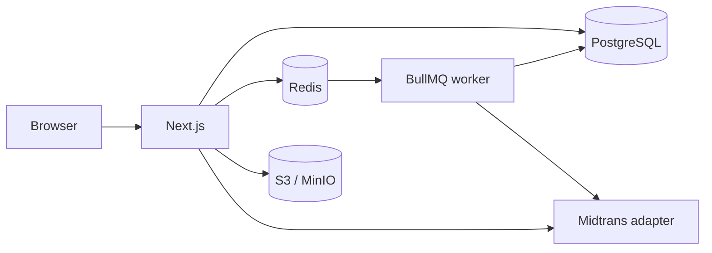

# Arsitektur

Target adalah modular monolith Next.js App Router dengan lapisan layanan dan repositori; PostgreSQL adalah sumber kebenaran, Redis untuk antrean/rate limit, worker BullMQ untuk rekonsiliasi dan analitik, dan object storage S3-compatible untuk media. Semua otorisasi, deadline dan scoring berlaku di server. Status implementasi aktual ada di IMPLEMENTATION_STATUS.md.

Sesi ujian harus menyimpan versi soal dan urutan opsi, dan endpoint soal aktif tidak boleh mengirim kunci, bobot, atau pembahasan. Gunakan transaksi untuk kuota, submit, dan aktivasi pembayaran; webhook diverifikasi dan deduplikasi di database.
