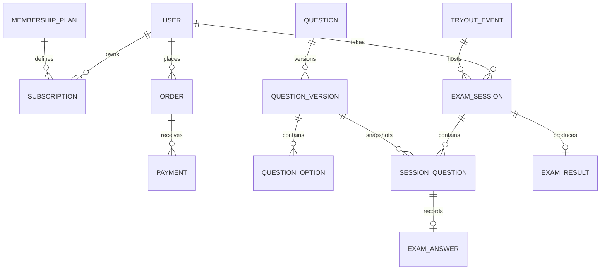

# ERD target

Model berikut adalah rancangan, belum berupa migrasi yang dijalankan. FK, indeks dan aturan penghapusan harus ditetapkan saat implementasi; versi soal dan riwayat keuangan tidak boleh terhapus secara kaskade.

Entitas pendukung yang masih harus dimodelkan: auth_sessions, password_reset_tokens, usage_records, payment_webhook_events, categories, topics, question_import_batches, media_assets, question_media, option_media, tryout_registrations, question_statistics, question_reports, question_reviews, question_quality_flags, audit_logs, risk_registers, risk_mitigations, incidents, incident_actions, monitoring_rules dan system_alerts.
